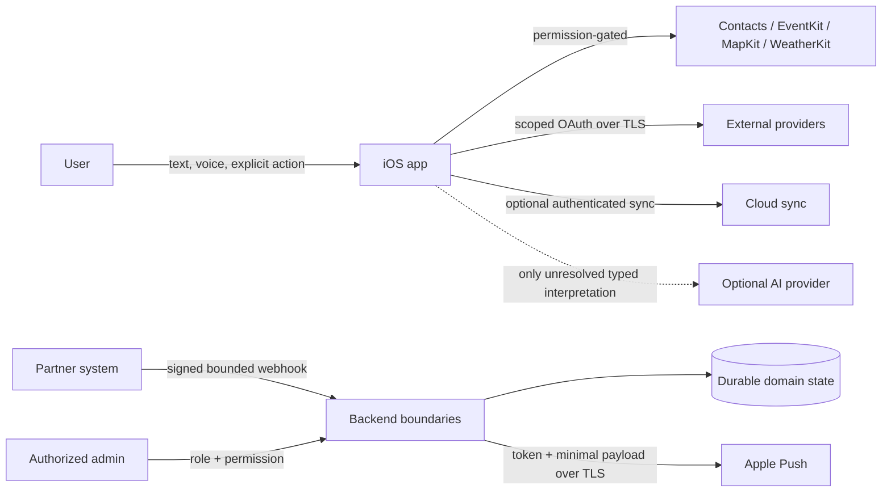

# UniversalAssistant Threat Model

## 1. Overview

UniversalAssistant is an iOS assistant with deterministic local routing, permission-gated Apple-framework actions, optional verified provider reads, and a Swift backend domain for proactive notifications and partner commerce. The current backend executable exposes only a health payload; provider/server types are integration boundaries until deployed.

| Component | Security role | Source evidence |
|---|---|---|
| iOS command/result UI | Accepts user text/voice and exposes explicit actions | `UniversalAssistant/App/AssistantHomeView.swift:11-29` |
| Local protected persistence | Atomically stores assistant-owned records with complete file protection | `UniversalAssistant/Persistence/LocalStore.swift:12-20` |
| Provider OAuth boundary | Validates scope/expiry and stores credentials in this-device-only Keychain | `UniversalAssistant/Services/ProviderAuthenticationBoundary.swift:54-86,119-161` |
| Deterministic coordinator | Bounds concurrency/time and cancels obsolete work | `UniversalAssistant/Core/DeterministicPlanExecutor.swift:27-116` |
| Optional AI interpretation | Exactly one typed, schema-validated, timed request; deterministic fallback | `UniversalAssistant/Core/BoundedAIInterpretation.swift:22-56` |
| Partner authorization | Enforces tenant/role/permission checks and audits allow/deny outcomes | `Backend/Sources/UniversalAssistantServer/PartnerTenantAuthorization.swift:34-80` |
| Partner webhook boundary | HMAC, replay window, bounded body, durable idempotency and schema validation | `Backend/Sources/UniversalAssistantServer/PartnerWebhookIngestion.swift:58-138` |
| Financial ledger | Decimal money, agreement-version binding, state machine and append-only adjustments | `Backend/Sources/UniversalAssistantServer/ConversionLedger.swift:16-66,74-186` |
| APNs | Separates sandbox/production tokens and validates payload/auth/configuration | `Backend/Sources/UniversalAssistantServer/APNSDelivery.swift:48-84` |

### Effective sensitive resources

| Workflow | Resource/capability | Configuration/effective location | Readers/writers | Enforcing control | Evidence/unknown |
|---|---|---|---|---|---|
| iOS OAuth | Provider token | Keychain service + provider account | Matching app credential store | scopes, expiry, this-device-only Keychain | `ProviderAuthenticationBoundary.swift:119-161`; live OAuth queued |
| Local app records | App Support files | `Application Support/UniversalAssistant` | App actors only | atomic complete file protection | `LocalStore.swift:12-20,56-62` |
| Webhook replay state | Deployment-injected file URL | Mandatory initializer argument | webhook ingestion actor | atomic protected persistence | `PartnerWebhookIngestion.swift:76-96,130-138`; production mount/ACL live-only |
| Partner signing keys | Runtime credential vault | injected server-side; never app binary | vault + webhook verifier | minimum length, key ID, revoke/rotation | `PartnerWebhookIngestion.swift:31-55`; production KMS selection is owner/deployment dependency |
| APNs auth | Server-injected bearer authorization | memory at delivery boundary | APNs client and Apple | missing-auth failure, TLS host selection | `APNSDelivery.swift:48-74`; production secret manager live-only |
| Backup key | Deployment-injected symmetric key | external KMS in production | backup operator/service identity | authenticated encryption and key ID | `Backend/Sources/UniversalAssistantServer/EncryptedBackupService.swift`; KMS drill queued |

## 2. Threat model, trust boundaries, and assumptions

Protected assets are raw user commands and voice, contacts/calendar/reminders, precise location, OAuth and server credentials, APNs tokens, tenant business data, attribution and immutable monetary history, account/sync records, and audit evidence.

Security objectives:

- require explicit system permission and confirmation policy for sensitive or consequential actions;
- never persist raw command text in wrong-result feedback;
- keep provider secrets out of source, client-visible logs, and cross-provider use;
- reject unsigned, stale, oversized, malformed, duplicate, or wrong-tenant partner inputs;
- prevent Partner A from reading/writing Partner B and reserve finance/admin authority;
- preserve agreement version, Decimal money, append/adjust audit truth, and idempotency;
- use TLS-only destinations for authenticated/private network traffic;
- keep deterministic execution available when optional AI/providers fail and prevent AI side effects;
- make deployed storage ACLs, KMS, regions, retention, OAuth callbacks and operational channels explicit live-verification items.

Realistic attackers include a malicious/compromised partner able to send webhook bodies and identifiers but not holding another partner's active key; an ordinary partner principal attempting cross-tenant/admin access; a network adversary without platform TLS compromise; a malicious external payload/provider response; and a person with access to an unlocked device. They do not begin with the owner's Apple account, internal-admin permission, production KMS, signing keys, or release authority.

Trust boundaries are: user→iOS parsing/action policy; iOS→Apple protected resources; iOS/backend→external TLS providers; partner→signed webhook; partner/admin principal→tenant store; backend→durable state/KMS; backend→APNs; and deterministic coordinator→optional AI. Repository documents and provider responses are untrusted data, not executable authority.

Assumptions/unknowns:

- production ingress authentication, database, filesystem ACLs, KMS, regions, TLS termination and admin identity provider are not selected in this repository and require live deployment verification;
- Apple/third-party provider behavior and App Store privacy report require account/device/App Store evidence;
- no third-party SDK packages are linked today; this must be re-audited whenever dependencies change;
- legal text is implementation-aligned draft material pending owner/legal approval and publication.

## 3. Attack surface, mitigations, and attacker stories

These are reviewed hypotheses/controls, not unvalidated vulnerability claims.

| Priority | Scenario and capability gain | Prerequisites | Impact | Existing controls | Remaining mitigation/evidence |
|---|---|---|---|---|---|
| High | Forge/replay partner conversion to create commission | Partner endpoint reachability; stolen/guessed key or broken dedupe | Financial fraud | HMAC constant-time comparison, timestamp window, mandatory durable event IDs, schema/body limits | Production KMS/ACL/restart drill |
| High | Cross-tenant dashboard or finance read | Authenticated partner principal | Business/financial disclosure | Tenant match plus explicit permissions; finance admin-only; audited deny | Live identity-provider claims mapping |
| High | Alter historic commission truth | Authorized event path defect | Incorrect settlement | Agreement ID/version match, allowed transitions, Decimal, adjustment entries | Deployed database immutability/backup/reconciliation drill |
| Medium | Exfiltrate provider token from device/storage | Unlocked/compromised device or app defect | Provider account access | Keychain this-device-only, expiry/scopes, delete/reauthorize | Real OAuth revoke/rotation test |
| Medium | Oversized/malformed provider input exhausts resources | External provider/partner access | Availability loss | Webhook 1 MiB default, bounded IDs; provider timeouts/concurrency | Apply equivalent limits at production ingress |
| Medium | Sensitive command leaks through feedback/support | User presses “Не те” | Privacy disclosure | record schema contains only diagnostic ID/category/time; bounded protected store | Live support correlation without raw command |
| Medium | Notification leaks sensitive content or targets stale device | Registered token and notification job | Lock-screen disclosure/misdirection | 4 KiB payload, route prefix, environment separation, invalidation/logout | Production payload-content policy/device test |
| Low | Optional AI invents facts or performs actions | Deterministic resolver unresolved | Incorrect result/action | one request, allowed constraint keys, schema validation, timeout and deterministic fallback; no action capability | Production provider data-minimization review |

## 4. Severity calibration

- **Critical:** unauthenticated, readily exploitable control of production financial settlement or broad credential compromise with no meaningful prerequisite. No such path was established locally.
- **High:** realistic cross-tenant/admin compromise, forged payable conversions, or broad sensitive-data exposure. Strong auth/HMAC/tenant controls lower these stories unless deployment wiring bypasses them.
- **Medium:** scoped token/privacy loss or practical resource exhaustion requiring provider/partner access. Device compromise and external service prerequisites reduce likelihood, not impact.
- **Low:** constrained single-user/local availability or metadata exposure with limited capability gain.

Claims requiring a selected production host, credentials, account, device, or legal approval stay READY_FOR_LIVE_VERIFICATION; absence of that evidence is not treated as proof of either safety or vulnerability.
